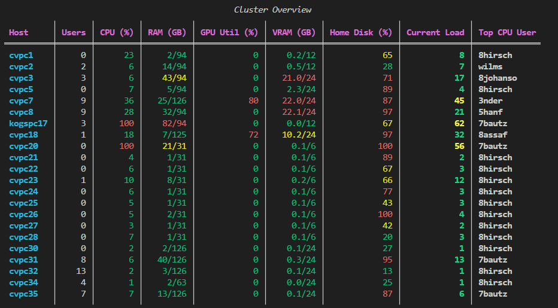

# Usage

`uvx remote-gpu-stats <username>` where `<username>` is your SSH username for the informatik pcs.

## Authentication

By default you are prompted for your SSH password.

- Set the `REMOTE_GPU_STATS_PASSWORD` environment variable to skip the prompt, e.g. for unattended use.
- Or create a `.env` file in the project root containing `REMOTE_GPU_STATS_PASSWORD=...` (it is gitignored).
- Use `--use-default-key` to opt in to SSH key authentication with `~/.ssh/id_ed25519` (or `~/.ssh/id_rsa`). Key auth is never used unless this flag is given; the password prompt remains the default. The public half of the key must be installed on the gateway and each host (see `ssh-copy-id`).

## Options

| Flag                | Description                                                                                      |
|---------------------|--------------------------------------------------------------------------------------------------|
| `--use-default-key` | Authenticate with your local SSH key instead of a password (see above).                          |
| `--history`         | List saved runs from previous executions. Requires no cluster access.                            |
| `--show <N>`        | Re-display saved run N (1 = most recent) instead of collecting fresh metrics.                    |
| `--latest`          | Re-display the most recent saved run (same as `--show 1`).                                       |

## Saved run history

Every successful collection is automatically saved as a JSON snapshot so you can inspect results from earlier runs without paying the collection time again. Snapshots live in `%LOCALAPPDATA%\remote-gpu-stats\` on Windows and `~/.cache/remote-gpu-stats/` elsewhere; the 50 most recent runs are kept.

- `remote-gpu-stats --history` lists saved runs with timestamps and relative ages.
- `remote-gpu-stats --show 3` re-renders run #3; `--latest` (or `--show 1`) shows the most recent one.
- The history flags work without SSH auth and can be used standalone (no `username` required).

Hosts that do not respond within 5 seconds are skipped and reported as such; the remaining hosts are still collected.

# Example

https://www.inf.uni-hamburg.de/inst/irz/infrastructure/news.html